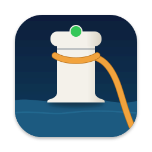
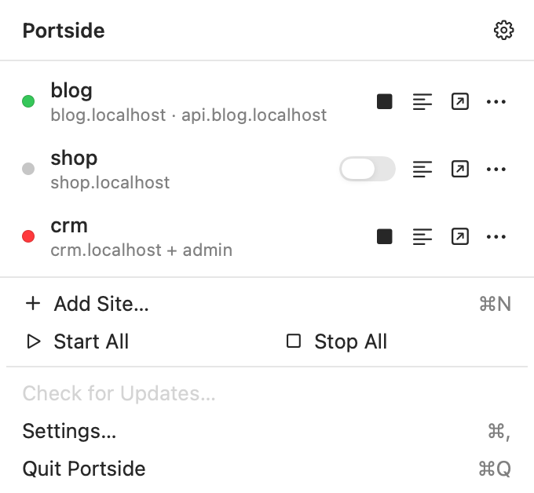
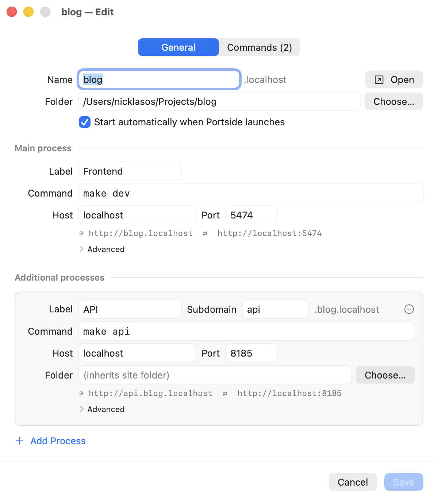
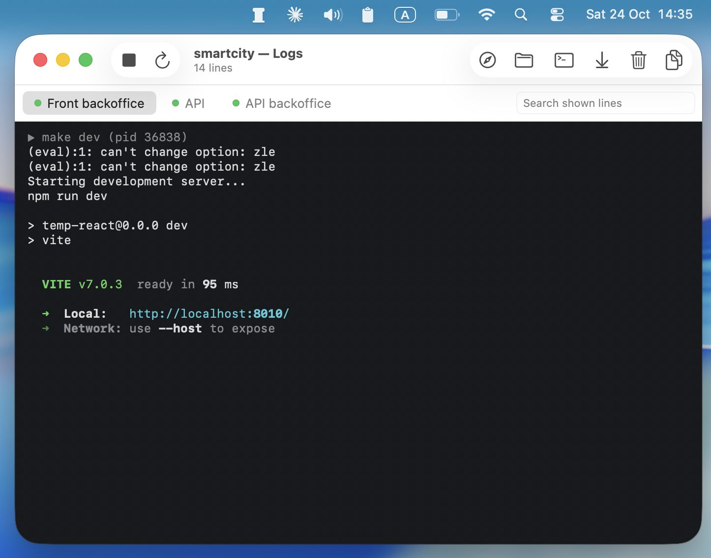

<p align="center">
  
</p>

<h1 align="center">Portside</h1>

<p align="center">Your local dev servers, on <code>*.test</code> domains, from the menu bar.</p>

<p align="center">
  <a href="https://github.com/nicklasos/portside/releases/latest"></a>
  <a href="https://github.com/nicklasos/portside/actions/workflows/ci.yml"></a>
  
  <a href="LICENSE"></a>
  <a href="https://github.com/nicklasos/portside/releases"></a>
</p>

<p align="center">
  
</p>

## What it does

- Maps `smartcity.test` to `localhost:5474`, and any other `*.test` name to the port you choose.
- Starts and stops every process of a project with one click.
- Shows each process's output in a tabbed log window, colors included.
- Puts additional processes on subdomains, such as `api.smartcity.test` for an API on port 8185.

## Install

1. Download `Portside-<version>.dmg` from the [latest release](https://github.com/nicklasos/portside/releases/latest).
2. Open the disk image and drag **Portside** to **Applications**.
3. Open Portside. macOS blocks the first launch, because Portside is a free project without a paid Apple Developer ID and is not notarized.
   - On macOS 14, Control-click Portside in **Applications** and choose **Open**.
   - On macOS 15 or later, open **System Settings > Privacy & Security** and click **Open Anyway** next to the Portside message.

   You do this once. Updates install in place through Sparkle and do not ask again.
4. When Portside asks, enter your administrator password. Portside writes one file, `/etc/resolver/test`, which tells macOS to send `.test` lookups to Portside. This is the only change outside your home folder.

A Homebrew cask is planned.

## Quick start

<p align="center">
  
</p>

1. Click the Portside icon in the menu bar, then click **Add Site** (⌘N).
2. Enter a name, such as `smartcity`, and choose the project folder. The site's domain is `smartcity.test`.
3. Enter the command that starts your dev server, such as `npm run dev`, and the port it listens on, such as `5474`.
4. To run an API or a worker too, click **Add** under **Additional processes**. Give it a subdomain, such as `api`, to reach it at `api.smartcity.test`.
5. Click **Save**, click the start button on the site's row, and then click the open button. Your browser opens `http://smartcity.test`.

Portside passes `PORT`, `HOST`, `PORTSIDE_SITE`, and `PORTSIDE_URL` to each command. A command such as `npm run dev -- --port $PORT` stays in step with the port you entered. Leave the command empty to serve the folder as static files.

## How it works

<p align="center">
  
</p>

**DNS.** Portside runs a small DNS server on `127.0.0.1:35353` that answers every `*.test` name with `127.0.0.1` and `::1`. The file `/etc/resolver/test` tells macOS to ask that server for `.test` names only. Every other lookup goes to your normal DNS.

**Proxy.** Portside bundles [Caddy](https://caddyserver.com) and runs it on port 80. Caddy matches the `Host` header and forwards the request to the right local port. WebSockets pass through, so hot reload works. Caddy sets `Host` to the upstream address, such as `localhost:5474`, so dev servers that check the host accept the request. The original host goes in `X-Forwarded-Host`. Turn on **Preserve Host header** for a process that needs the real host. When a site is stopped, its domain shows a Portside page that tells you to start it.

**Process groups.** Each command runs under `/bin/zsh -lc` in its own process group. `make dev` and `npm run dev` fork child processes, and stopping only the parent would leave a child holding the port. Portside sends `SIGTERM` to the whole group, waits 5 seconds, then sends `SIGKILL`. If Portside crashes, it kills the leftover groups the next time it starts.

[`docs/ARCHITECTURE.md`](docs/ARCHITECTURE.md) covers the details.

## Logs

<p align="center">
  
</p>

Each site has a log window with one tab per process, main process first. The window keeps the last 10,000 lines of each process and renders ANSI colors. It scrolls with new output until you scroll up. From the toolbar you can start, stop, or restart one process, search, copy the output, and open the folder in Finder or Terminal. To keep logs on disk as well, turn on log mirroring in **Settings**. Portside then writes `~/Library/Logs/Portside/<site>/<process>.log`.

## FAQ

### Portside says port 80 is in use

Another program is listening on port 80. Portside shows its name and pid. Common owners are Laravel Herd, Laravel Valet, Homebrew nginx or Apache, and Docker containers that publish port 80. Either stop that program, or move Portside to another port:

1. Open **Settings > Network**.
2. Set the proxy port to `8080`.

Your URLs then gain the port, for example `http://smartcity.test:8080`. Portside shows and opens the new URLs.

### Can I use Portside next to Laravel Herd or Valet?

Not both on `.test` at the same time. Herd, Valet, and Portside each claim `.test` through the same file, `/etc/resolver/test`, and macOS reads only one. When Portside finds a resolver file that another tool wrote, it asks before it replaces the file. Herd and Valet also listen on port 80, so set Portside's proxy port to `8080` while they run.

To switch back to Herd or Valet, quit Portside and use Herd's own repair, or run `valet install` for Valet. You can also restore the file by hand:

```sh
sudo sh -c 'printf "nameserver 127.0.0.1\n" > /etc/resolver/test'
```

### Vite says "Blocked request" or "Invalid Host header"

By default, Portside rewrites `Host` to the upstream address, such as `localhost:5474`, which dev servers accept. If you turned on **Preserve Host header** for the process, the dev server sees `smartcity.test` and may reject it. Vite 6 and later need the domain in `server.allowedHosts`:

```js
// vite.config.js
export default {
	server: {
		allowedHosts: ['.test'],
	},
}
```

A leading dot allows every subdomain of `.test`.

### My command fails with "command not found"

Portside runs each command with `/bin/zsh -lc`, a login shell that is not interactive. That shell reads `~/.zshenv`, `~/.zprofile`, and `~/.zlogin`. It does not read `~/.zshrc`. If a tool such as nvm, asdf, or pyenv sets up `PATH` in `~/.zshrc`, move those lines to `~/.zprofile`, or use the tool's full path in the command. The log window shows the shell's error, such as `zsh:1: command not found: npm`.

### Does Portside support HTTPS?

Not yet. Portside serves plain HTTP. HTTPS through Caddy's local certificate authority is planned for v1.1.

### How do I uninstall Portside?

1. Quit Portside. Quitting stops every process it started.
2. Remove the resolver file:

	```sh
	sudo rm /etc/resolver/test
	```

3. Drag `Portside.app` from **Applications** to the Trash.
4. Remove the settings and logs:

	```sh
	rm -rf ~/Library/Application\ Support/Portside ~/Library/Logs/Portside
	defaults delete com.nicklasos.portside
	```

## Development

You need Xcode 15.4 or later and [Homebrew](https://brew.sh).

```sh
./scripts/bootstrap.sh
open Portside.xcodeproj
```

`bootstrap.sh` installs XcodeGen if it is missing, downloads the pinned Caddy release into `Portside/Resources/caddy`, and generates `Portside.xcodeproj` from `project.yml`. After you change `project.yml`, run `xcodegen generate` again.

Run the unit tests with ⌘U in Xcode, or from the command line:

```sh
xcodebuild -project Portside.xcodeproj -scheme Portside -destination 'platform=macOS' CODE_SIGNING_ALLOWED=NO test
```

- [`docs/ARCHITECTURE.md`](docs/ARCHITECTURE.md) describes the components, the request flow, and the process lifecycle.
- [`docs/TESTING.md`](docs/TESTING.md) lists the unit tests and the manual checklist for a release.
- [`docs/PLAN.md`](docs/PLAN.md) is the original design and roadmap.

## Releasing

[`docs/RELEASING.md`](docs/RELEASING.md) covers the signing key, version bumps, and the tag that publishes a release.

## Acknowledgements

- [Laravel Herd](https://herd.laravel.com) inspired Portside's one-click local domains.
- [puma-dev](https://github.com/puma/puma-dev) showed the `/etc/resolver` technique with a DNS server on a high port.
- [Caddy](https://caddyserver.com) is the reverse proxy. Portside bundles it under the Apache-2.0 license, and the app includes the license file.
- [Sparkle](https://sparkle-project.org) delivers updates.
- [SwiftNIO](https://github.com/apple/swift-nio) runs the DNS server.

## License

Portside is released under the [MIT license](LICENSE).
