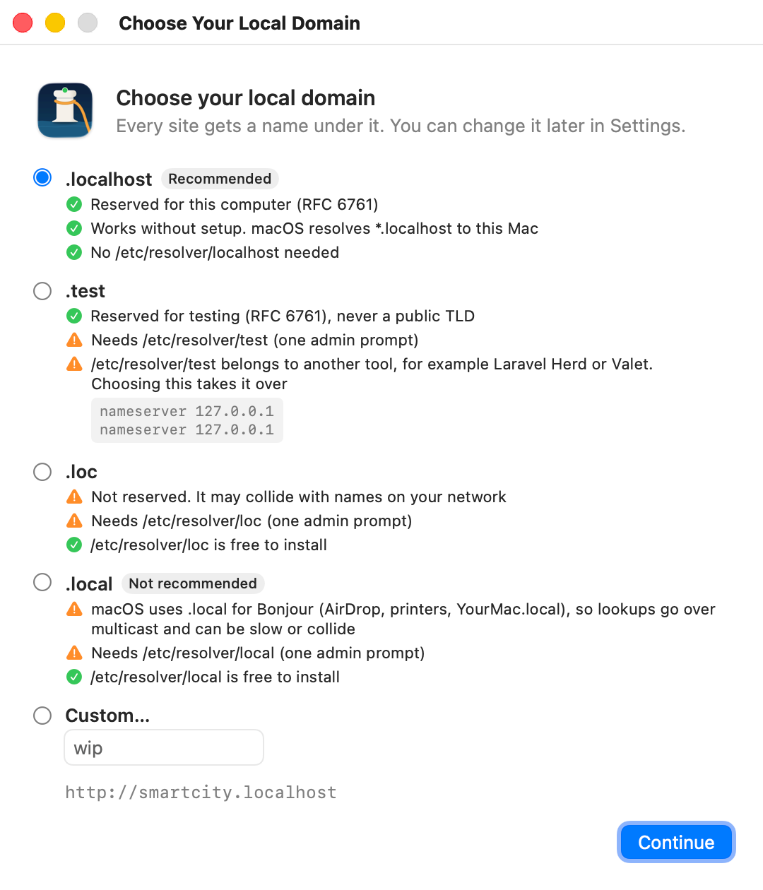

<p align="center">
  
</p>

<h1 align="center">Portside</h1>

<p align="center">Your local dev servers, on <code>*.localhost</code> domains, from the menu bar.</p>

<p align="center">
  <a href="https://github.com/nicklasos/portside/releases/latest"></a>
  <a href="https://github.com/nicklasos/portside/actions/workflows/ci.yml"></a>
  
  <a href="LICENSE"></a>
  <a href="https://github.com/nicklasos/portside/releases"></a>
</p>

<p align="center">
  
</p>

## What it does

- Maps `blog.localhost` to `localhost:5474`, and any other site name to the port you choose.
- Starts and stops every process of a project with one click.
- Shows each process's output in a tabbed log window, colors included.
- Puts additional processes on subdomains, such as `api.blog.localhost` for an API on port 8185.
- Uses `.localhost` by default, which macOS resolves with no setup. You can choose `.test`, `.loc`, `.local`, or your own suffix instead.

## Install

1. Download `Portside-<version>.dmg` from the [latest release](https://github.com/nicklasos/portside/releases/latest).
2. Open the disk image and drag **Portside** to **Applications**.
3. Open Portside. macOS blocks the first launch, because Portside is a free project without a paid Apple Developer ID and is not notarized. Allow it once, as described in [First launch](#first-launch). Updates install in place through Sparkle and do not ask again.
4. Choose your local domain. Portside lists `.localhost`, `.test`, `.loc`, `.local`, and a custom suffix, and shows what each one needs on your Mac. `.localhost` needs no setup and no password.

   Any other suffix needs one file, `/etc/resolver/<suffix>`, which tells macOS to send that suffix's lookups to Portside. Portside explains the file and waits for you to click **Install Resolver**. Then macOS asks for your administrator password once. The resolver file is the only change outside your home folder.

<p align="center">
  
</p>

A Homebrew cask is planned.

### First launch

macOS shows a warning the first time you open Portside, because the app is not notarized by Apple. You allow it once.

**macOS 15 Sequoia and later**

1. Open Portside from **Applications**. macOS says it could not verify that Portside is free of malware. Click **Done**.
2. Open **System Settings > Privacy & Security** and scroll down to **Security**. Next to "Portside was blocked to protect your Mac", click **Open Anyway**.
3. Click **Open Anyway** again in the dialog and confirm with your password or Touch ID.

Portside starts, and macOS remembers your choice.

**macOS 14 Sonoma**

Control-click Portside in **Applications**, choose **Open**, then click **Open** in the dialog.

**From Terminal, any version**

If you prefer one command, remove the download quarantine flag and open the app normally:

```sh
xattr -dr com.apple.quarantine /Applications/Portside.app
```

## Quick start

<p align="center">
  
</p>

1. Click the Portside icon in the menu bar, then click **Add Site** (⌘N).
2. Choose the project folder. The name fills in from the folder name, and you can change it. For a name such as `blog`, the site's domain is `blog.localhost`.
3. Check the command that starts your dev server and the port it listens on. Portside fills the command from the folder when it can, such as `npm run dev` from a `dev` script in `package.json`, `make dev` from a Makefile, or `php artisan serve --port=$PORT` for Laravel, and says which file it used. If the folder has a `.env` with a port, such as `PORT` or `APP_PORT`, Portside fills the port in and says which key it used. When the command is empty, the line under it says the site is static.
4. To run an API or a worker too, click **Add Process** under **Additional processes**. Give it a subdomain, such as `api`, to reach it at `api.blog.localhost`. The remove button at the end of a process's first row takes it out again.
5. Click **Save**, click the start button on the site's row, and then click the open button. Your browser opens `http://blog.localhost`.

Portside passes `PORT`, `HOST`, `PORTSIDE_SITE`, and `PORTSIDE_URL` to each command. A command such as `npm run dev -- --port $PORT` stays in step with the port you entered. Leave the command empty to serve the folder as static files. A static site has a switch in the menu instead of start and stop buttons.

## Commands

A site can also hold commands that you run when you need them, such as a deploy or a database seed. Open the site editor and choose **Commands** in the control at the top. Click **Add Command**, name it, such as `Deploy`, and enter the shell line, such as `make deploy && echo "ok"`. The command runs in the site folder unless you choose another folder.

The site's … menu in the popover lists its commands. Choose one to run it. With **Show logs** on, the logs window opens on the command's tab. With it off, the command runs in the background, and a notification says whether it finished or failed. While a command runs, its menu item reads **Stop Deploy**. Stopping the site leaves a running command alone.

Each command gets `PORTSIDE`, `PORTSIDE_SITE`, and `PORTSIDE_URL`, the site's main URL.

## How it works

<p align="center">
  
</p>

**DNS.** macOS 26 resolves every `*.localhost` name to `127.0.0.1` and `::1` by itself, and Chrome and Firefox do the same. Portside does not assume this. At launch it looks up a random name under your suffix, and when the answer is loopback, Portside runs no DNS server. Otherwise, for example with `.test`, Portside runs a small DNS server on `127.0.0.1:35353` that answers every name under the suffix with `127.0.0.1` and `::1`. The file `/etc/resolver/<suffix>` tells macOS to ask that server for that suffix only. Every other lookup goes to your normal DNS. The diagram shows the `.test` path.

**Proxy.** Portside bundles [Caddy](https://caddyserver.com) and runs it on port 80. Caddy matches the `Host` header and forwards the request to the right local port. WebSockets pass through, so hot reload works. Caddy sets `Host` to the upstream address, such as `localhost:5474`, so dev servers that check the host accept the request. The original host goes in `X-Forwarded-Host`. Turn on **Preserve Host header** for a process that needs the real host. When a site is stopped, its domain shows a Portside page that tells you to start it.

**Check.** **Settings > Network** shows whether your suffix works. **Test Now** looks up `portside-selftest.<suffix>` and requests it through Caddy, which answers with a marker. When the check fails, it names the step: DNS, the proxy port, or Caddy.

**Process groups.** Each command runs under `/bin/zsh -ilc` in its own process group. `make dev` and `npm run dev` fork child processes, and stopping only the parent would leave a child holding the port. Portside sends `SIGTERM` to the whole group, waits 5 seconds, then sends `SIGKILL`. If Portside crashes, it kills the leftover groups the next time it starts.

[`docs/ARCHITECTURE.md`](docs/ARCHITECTURE.md) covers the details.

## Logs

<p align="center">
  
</p>

Each site has a log window with one tab per process, main process first, then a tab for each command that ran since Portside started. The window keeps the last 10,000 lines of each process and renders ANSI colors. It scrolls with new output until you scroll up. The line count sits under the window title. The toolbar's left edge starts, stops, or restarts the selected process. Its right edge opens the site in the browser, opens the folder in Finder or Terminal, and holds Follow, Clear, and Copy All. The tabs sit in a bar under the toolbar, with a search field for the shown lines at its end. ⌘F focuses the search. To keep logs on disk as well, turn on log mirroring in **Settings**. Portside then writes `~/Library/Logs/Portside/<site>/<process>.log`, and `<command>.log` for a command.

## FAQ

### Portside says port 80 is in use

Another program is listening on port 80. Portside shows its name and pid. Common owners are Laravel Herd, Laravel Valet, Homebrew nginx or Apache, and Docker containers that publish port 80. Either stop that program, or move Portside to another port:

1. Open **Settings > Network**.
2. Set the proxy port to `8080`.

Your URLs then gain the port, for example `http://blog.localhost:8080`. Portside shows and opens the new URLs.

### Can I use Portside next to Laravel Herd or Valet?

Yes, with the default `.localhost` suffix. Herd and Valet own `.test` through `/etc/resolver/test`. `.localhost` needs no resolver file, so Portside never touches theirs.

Port 80 still conflicts. Herd and Valet run nginx on port 80, and only one program can listen there. Set Portside's proxy port to `8080` in **Settings > Network**, and your sites open at `http://blog.localhost:8080`.

If you choose `.test` instead, Portside and Herd claim the same file, and macOS reads only one. Portside shows the other tool's file and asks before it replaces it. To give `.test` back to Herd or Valet, quit Portside and use Herd's own repair, or run `valet install` for Valet. You can also restore the file by hand:

```sh
sudo sh -c 'printf "nameserver 127.0.0.1\n" > /etc/resolver/test'
```

### Which suffix should I choose?

Keep `.localhost` unless you have a reason not to. It needs no setup and is reserved for your own computer.

- `.test` is reserved for testing and gives shorter names. It needs `/etc/resolver/test`, which Herd and Valet also use.
- `.loc` is not reserved. A device or a DNS server on your network may already answer it.
- `.local` belongs to Bonjour. macOS sends `.local` lookups out as multicast for AirDrop, printers, and `YourMac.local`, so they can be slow or collide. Portside offers it, but does not recommend it.
- A custom suffix must be one label of lowercase letters, digits, and dashes. Portside refuses real public TLDs such as `.com` and `.io`, and HSTS-preloaded TLDs such as `.dev` and `.app`, which make browsers refuse plain HTTP.

To change the suffix later, open **Settings > Network**. Running processes keep the old `PORTSIDE_URL` until you restart them. If Portside wrote a resolver file for the old suffix, Settings offers to remove it.

### Vite says "Blocked request" or "Invalid Host header"

By default, Portside rewrites `Host` to the upstream address, such as `localhost:5474`, which dev servers accept. If you turned on **Preserve Host header** for the process, the dev server sees the real domain. Vite 6 and later accept `*.localhost` names by default. For `.test` or another suffix, add the suffix to `server.allowedHosts`:

```js
// vite.config.js
export default {
	server: {
		allowedHosts: ['.test'],
	},
}
```

A leading dot allows every subdomain of `.test`.

### My command fails with "command not found"

Portside runs each command with `/bin/zsh -ilc`, an interactive login shell. It reads `~/.zshenv`, `~/.zprofile`, `~/.zshrc`, and `~/.zlogin`, so nvm, fnm, asdf and Homebrew resolve the same way they do in your terminal. If a command still is not found, check that your shell setup does not depend on a terminal being attached, or use the tool's full path. The log window shows the shell's error, such as `zsh:1: command not found: npm`.

### Does Portside support HTTPS?

Not yet. Portside serves plain HTTP. HTTPS through Caddy's local certificate authority is planned for v1.1.

### How do I uninstall Portside?

1. Quit Portside. Quitting stops every process it started.
2. If you chose a suffix other than `.localhost`, remove its resolver file, for example:

	```sh
	sudo rm /etc/resolver/test
	```

3. Drag `Portside.app` from **Applications** to the Trash.
4. Remove the settings and logs:

	```sh
	rm -rf ~/Library/Application\ Support/Portside ~/Library/Logs/Portside
	defaults delete com.nicklasos.portside
	```

## Development

You need Xcode 16.3 or later (Swift 6.1 tools, required by swift-nio) and [Homebrew](https://brew.sh).

```sh
./scripts/bootstrap.sh
open Portside.xcodeproj
```

`bootstrap.sh` installs XcodeGen if it is missing, downloads the pinned Caddy release into `Portside/Resources/caddy`, and generates `Portside.xcodeproj` from `project.yml`. After you change `project.yml`, run `xcodegen generate` again.

Run the unit tests with ⌘U in Xcode, or from the command line:

```sh
xcodebuild -project Portside.xcodeproj -scheme Portside -destination 'platform=macOS' CODE_SIGNING_ALLOWED=NO test
```

- [`docs/ARCHITECTURE.md`](docs/ARCHITECTURE.md) describes the components, the request flow, and the process lifecycle.
- [`docs/TESTING.md`](docs/TESTING.md) lists the unit tests and the manual checklist for a release.
- [`docs/PLAN.md`](docs/PLAN.md) is the original design and roadmap.

## Releasing

[`docs/RELEASING.md`](docs/RELEASING.md) covers the signing key, version bumps, and the tag that publishes a release.

## Acknowledgements

- [Laravel Herd](https://herd.laravel.com) inspired Portside's one-click local domains.
- [puma-dev](https://github.com/puma/puma-dev) showed the `/etc/resolver` technique with a DNS server on a high port.
- [Caddy](https://caddyserver.com) is the reverse proxy. Portside bundles it under the Apache-2.0 license, and the app includes the license file.
- [Sparkle](https://sparkle-project.org) delivers updates.
- [SwiftNIO](https://github.com/apple/swift-nio) runs the DNS server.

## License

Portside is released under the [MIT license](LICENSE).
