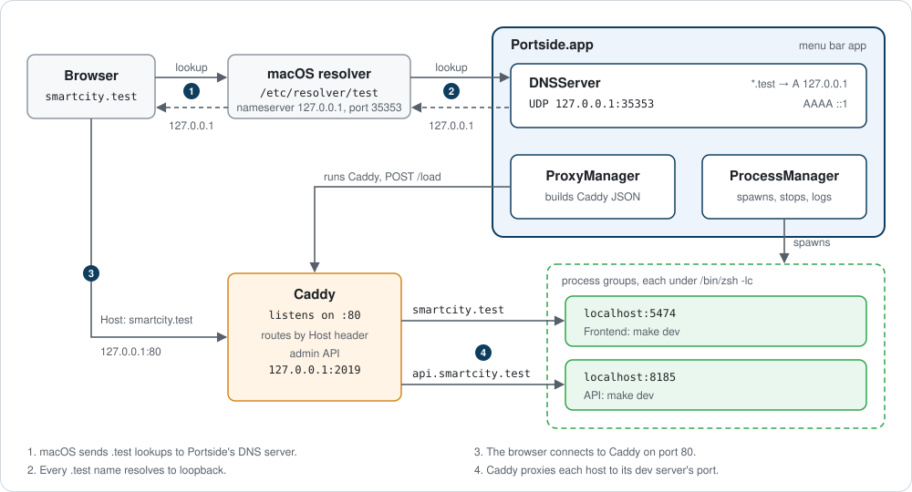

# Portside architecture

Portside is one menu bar process that runs three things for you. A bundled Caddy reverse proxy routes each site's host, such as `blog.localhost`, to a local port. A process manager starts your dev commands in their own process groups and keeps their output. A DNS server answers names under the chosen domain suffix with a loopback address, and it runs only when macOS does not already resolve that suffix. This document describes how those parts fit together, as the code implements them. [`PLAN.md`](PLAN.md) holds the original design and the roadmap.

The diagram shows the `.test` path. With the default `.localhost` suffix, macOS answers the lookup itself and the DNS server does not run.

## Components

Each service owns one concern. The UI layer in [`Portside/App`](../Portside/App) and [`Portside/Views`](../Portside/Views) reads their observable state and calls their methods.

| Component | Source | Owns |
| --- | --- | --- |
| `SiteStore` | [`Store/SiteStore.swift`](../Portside/Store/SiteStore.swift) | The list of sites. Validates a site before it saves it, and writes `sites.json` after every change. |
| `Persistence` | [`Store/Persistence.swift`](../Portside/Store/Persistence.swift) | Reading and atomically writing `sites.json`. |
| `AppSettings` | [`Store/AppSettings.swift`](../Portside/Store/AppSettings.swift) | Preferences in `UserDefaults`: domain suffix (`localhost`), whether the user has chosen it, proxy port (80), DNS port (35353), Caddy admin port (2019), crash notifications (on), and log mirroring to disk (off). **Reset to Defaults** keeps the domain suffix. |
| `DomainSuffix` | [`Models/DomainSuffix.swift`](../Portside/Models/DomainSuffix.swift) | The top-level label every site lives under. The presets are `.localhost`, `.test`, `.loc`, and `.local`. `DomainSuffix.custom(_:)` validates a typed suffix and is the only other way to make one. |
| `SiteValidation` | [`Models/SiteValidation.swift`](../Portside/Models/SiteValidation.swift) | The rules a site must pass. Errors block a save. A shared `host:port` is only a warning. |
| `ProcessManager` | [`Services/ProcessManager.swift`](../Portside/Services/ProcessManager.swift) | The state of every process, the spawned groups, one `LogBuffer` per process, and the `pids.json` ledger. |
| `ManagedProcess` | [`Services/ManagedProcess.swift`](../Portside/Services/ManagedProcess.swift) | One spawned `/bin/zsh -ilc <command>` from spawn until its leader is reaped and its output is drained. |
| `Spawn` | [`Services/Spawn.swift`](../Portside/Services/Spawn.swift) | The `posix_spawn` call and the signals that stop a process group. |
| `LogBuffer` | [`Services/LogBuffer.swift`](../Portside/Services/LogBuffer.swift) | A line ring buffer of 10,000 lines per process, with an optional mirror file. |
| `DNSServer` | [`Services/DNSServer.swift`](../Portside/Services/DNSServer.swift) | The UDP DNS responder for one zone, the current suffix. |
| `ResolverInstaller` | [`Services/ResolverInstaller.swift`](../Portside/Services/ResolverInstaller.swift) | `/etc/resolver/<suffix>`: its status, and the privileged install and uninstall. |
| `SuffixUsability`, `EndToEndCheck` | [`Services/SuffixCheck.swift`](../Portside/Services/SuffixCheck.swift) | What Portside can tell about a suffix on this Mac, and the check that a browser would reach the proxy. `SuffixProbes` holds the lookup and the HTTP request, so tests can script them. |
| `EnvPortDetector` | [`Services/EnvPortDetector.swift`](../Portside/Services/EnvPortDetector.swift) | Guessing a project's port from `.env`, `.env.local`, `.env.development`, and `.env.development.local`, read in that order with later files winning. One priority table decides: `PORT`, then `APP_PORT`, `SERVER_PORT`, `HTTP_PORT`, `WEB_PORT`, `VITE_PORT`, `DEV_PORT`, then any other `*_PORT` key that does not name a database or service, then a `localhost` or `127.0.0.1` URL with a port in `APP_URL`, `BASE_URL`, `PUBLIC_URL`, `SITE_URL`, or `URL`. The site editor runs it when a folder is chosen. `FolderAutofill` fills an empty or default port and an empty name, and never replaces values the user typed. |
| `PortChecker` | [`Services/PortChecker.swift`](../Portside/Services/PortChecker.swift) | Checking whether a port is free, and naming the process that holds it. |
| `CaddyConfigBuilder` | [`Services/CaddyConfigBuilder.swift`](../Portside/Services/CaddyConfigBuilder.swift) | Turning sites into Caddy JSON. A pure function with golden-file tests. |
| `ProxyManager` | [`Services/ProxyManager.swift`](../Portside/Services/ProxyManager.swift) | The Caddy child process, its config file, and live reloads through the admin API. |

The models live in [`Portside/Models`](../Portside/Models). A `Site` has a `name`, a `folder`, one `main` process, zero or more `extras`, and an `autoStart` flag. A `ProcessConfig` has a `label`, a `command`, a `host`, a `port`, an optional `subdomain`, an optional `workingDirectory`, extra `env` variables, and `preserveHost`. Domains are not stored. `Site.domain(in:)` and `Site.domain(for:in:)` derive them from the site name, the process subdomain, and the current `DomainSuffix`. The main process answers on `<name>.<suffix>`. An extra process answers on `<subdomain>.<name>.<suffix>`, or on no domain when it has no subdomain. `PortsideController.domain(for:process:)` and `url(for:process:)` apply the current suffix for the UI. A main process with an empty command makes the site static: Caddy serves the folder and Portside spawns nothing.

## Domain suffix

The first launch opens a window that asks for the suffix. **Settings > Network** shows the same list. Each option shows three checked lines from `SuffixUsability.evaluate`:

| Line | Source |
| --- | --- |
| What the name means | `DomainSuffix.nameCheck`. `.localhost` and `.test` are reserved by RFC 6761. `.loc` and similar names are not reserved and may collide with names on the network. `.local` belongs to Bonjour, so lookups go out as multicast and can be slow or collide. |
| How this Mac resolves it | A `getaddrinfo` lookup of `portside-probe-<uuid>.<suffix>`. |
| Who owns `/etc/resolver/<suffix>` | The file's content: missing, Portside's own, or another tool's. Another tool's content is shown. |

`DomainSuffix.custom(_:)` rejects a malformed label, an all-digit label, the preset labels, the HSTS-preloaded TLDs such as `dev` and `app`, and common public TLDs such as `com` and `io`. Each rejection carries the reason the UI shows.

The same evaluation picks the `ResolutionStrategy`:

- `system`: no resolver file exists for the suffix, and every address the probe returns is loopback. macOS 26 resolves `*.localhost` this way. Portside runs no DNS server and asks for no password.
- `portsideDNS`: any other result. Portside starts `DNSServer` for the suffix and needs `/etc/resolver/<suffix>`.

A resolver file decides the strategy on its own. Herd's `/etc/resolver/test` makes `.test` resolve to `127.0.0.1` through Herd's dnsmasq, and that answer disappears when Herd stops, so it does not count as `system`.

`PortsideController.chooseDomainSuffix(_:)` stores the suffix, pushes the new hosts to Caddy, probes again, and then starts or stops the DNS server. It does not restart running processes. When something is running, it sets a notice that says to restart the sites to update `PORTSIDE_URL`. `staleResolvers` lists Portside's own resolver files for other suffixes, and Settings offers to remove each one through `ResolverInstaller.uninstall`.

### End-to-end check

`EndToEndCheck.run` runs at launch, after a resolver install, and from **Test now** in Settings. It reports the first step that fails:

1. DNS. `portside-selftest.<suffix>` must resolve to `127.0.0.53` under `portsideDNS`, which proves the answer came from Portside's server. Under `system`, it must resolve to loopback only.
2. The proxy state. A port conflict names the owner. A stopped or failed Caddy says so.
3. HTTP. `LoopbackHTTP.get` sends `GET /` with `Host: portside-selftest.<suffix>` to `127.0.0.1:<proxy port>`. Caddy's first route answers that host with `portside-ok`. The request goes to `127.0.0.1` because macOS routes only `127.0.0.1` on `lo0`, and a connection to `127.0.0.53` times out.

## Request flow

1. The browser asks macOS for `blog.localhost`.
2. With the `system` strategy, macOS answers `127.0.0.1` and `::1` itself. With `portsideDNS`, for example for `blog.test`, macOS reads `/etc/resolver/test`, which says `nameserver 127.0.0.1` and `port 35353`, and sends the query to Portside's `DNSServer`. `DNSServer` answers `127.0.0.1` for A queries and `::1` for AAAA queries.
3. The browser connects to port 80 on loopback and sends `Host: blog.localhost`.
4. Caddy matches the exact host and proxies the request to the process's upstream, for example `localhost:5474`. WebSocket upgrades pass through, so Vite HMR works.
5. `api.blog.localhost` matches its own route and goes to `localhost:8185`.

If you change the proxy port in Settings, URLs gain the port, for example `http://blog.localhost:8080`. `AppSettings.url(forDomain:)` builds every URL the app shows or opens.

## DNS

`DNSServer(port:zone:)` is a SwiftNIO `DatagramBootstrap` bound to `127.0.0.1` on the DNS port. It runs only under the `portsideDNS` strategy, and its zone is the current suffix. It speaks UDP only. `DNSServer.response(to:zone:)` is a pure function from query bytes to reply bytes, so the tests exercise it without a socket. The table uses `.test` as the zone.

| Query | Reply |
| --- | --- |
| A for a name whose last label is the zone | `127.0.0.1`, TTL 60, authoritative. |
| AAAA under `.test` | `::1`. Browsers stall on IPv6 lookups that time out, so Portside answers AAAA too. |
| ANY under `.test` | Both records. |
| Any other type under `.test` | NOERROR with no answers. |
| A name outside `.test` | NXDOMAIN, not authoritative. |
| A for `portside-selftest.test` | `127.0.0.53`. |
| A response, an opcode other than QUERY, more than one question, or a malformed packet | No reply. The packet is dropped. |

Names match case-insensitively, and the reply echoes the question bytes as sent.

The `127.0.0.53` answer exists for the end-to-end check. Laravel Herd, Valet, and dnsmasq setups also answer `.test` names with `127.0.0.1`. A plain lookup cannot tell whether macOS asked Portside or one of them. The check passes the DNS step only when `portside-selftest.<suffix>` resolves to `127.0.0.53`, which no other resolver returns.

`ResolverInstaller.status(contents:dnsPort:)` compares the directives of `/etc/resolver/<suffix>`, ignoring whitespace and comments, with `nameserver 127.0.0.1` and `port <dnsPort>`. It reports `installed`, `missing`, or `mismatched`. A Herd or Valet resolver file reads as `mismatched`. `ResolverInstaller.install(suffix:dnsPort:)` runs one AppleScript `do shell script ... with administrator privileges` that writes the file and flushes the caches with `dscacheutil -flushcache` and `killall -HUP mDNSResponder`. `ResolverInstaller.uninstall(suffix:dnsPort:)` uses the same path. Its shell command compares the file with Portside's exact content and removes it only on a match, so another tool's file stays even if it changed after Settings offered the removal. A cancelled password prompt throws `ResolverInstallError.cancelled`. Both calls happen only from a button click.

## Proxy

`ProxyManager.start(sites:enabledStaticSites:)` brings Caddy up in this order:

1. It kills a Caddy left over from a crashed Portside. The pid comes from `caddy/caddy.pid`, and the kill happens only when that pid's executable is named `caddy`.
2. It checks that the proxy port is free. If the port is taken, the state becomes `portConflict` with the owner's pid and command name from `lsof`.
3. It checks that the admin port is free. If not, the state becomes `failed`.
4. It writes `caddy.json` and runs `Contents/MacOS/caddy run --config <support>/caddy.json`. Caddy 2.11 reads JSON natively, so there is no `--adapter` flag. `XDG_CONFIG_HOME` and `XDG_DATA_HOME` point into `caddy/` under Application Support, so Caddy never writes to `~/.config`.
5. It polls `GET http://127.0.0.1:<admin>/config/` every 100 ms for up to 5 seconds. When Caddy answers, the state becomes `running`. When it does not, Portside stops Caddy and reports the last error line Caddy logged.

After that, `ProxyManager.apply(sites:enabledStaticSites:)` handles every change. It waits 200 ms for more changes, rebuilds the config, writes `caddy.json`, and posts it to `POST /load`. A rejected load sets `lastApplyError` and leaves the previous config running. A changed proxy or admin port takes effect on the next start. If Caddy exits on its own, the state becomes `failed` with Caddy's last error.

The admin API requests use an ephemeral `URLSession` with no system proxy and no cache.

### Config shape

[`CaddyConfigBuilder.build`](../Portside/Services/CaddyConfigBuilder.swift) first computes one `HostRoute` per domain, sorted by host, then renders JSON. The golden files in [`PortsideTests/Fixtures`](../PortsideTests/Fixtures) show the full output. The shape is:

- `admin.listen` is `127.0.0.1:<admin port>`, and `admin.config.persist` is `false`, so Caddy saves no copy of its config.
- The first route matches `portside-selftest.<suffix>` and returns `200 portside-ok` for the end-to-end check. `SiteValidation` rejects a site named `portside-selftest`.
- One server, `portside`, listens on `:<proxy port>`. macOS lets a process without root bind a port below 1024 only on the wildcard address, so the listener cannot be `127.0.0.1:80`. `automatic_https` is disabled.
- Each domain gets one route that matches the exact host and is `terminal`. Routes exist for every configured site, whether it runs or not.
- A route to a process with a command is a `reverse_proxy` to `host:port` with `flush_interval: -1`, so server-sent events and streams are not buffered. By default the route sets `Host` to the upstream's `host:port` and sets `X-Forwarded-Host` to the browser's host, because Vite and similar dev servers reject unknown hosts. A process with `preserveHost` passes the browser's `Host` through unchanged.
- An enabled static site's route is a `file_server` with the site folder as `root` and `index.html` as the index.
- A disabled static site's route returns a 503 "is not running" page.
- The last route has no matcher and returns a 404 "No site for this host" page.
- `errors.routes` matches every proxied host. When Caddy cannot reach the upstream, the browser gets a branded 502 page that says to start the site from the Portside menu bar.
- Each static site gets an access log in JSON at `~/Library/Logs/Portside/<site>/access.log`. The default log excludes those loggers.

## Process lifecycle

`ProcessState` in [`Models/SiteStatus.swift`](../Portside/Models/SiteStatus.swift) has five cases. `ProcessManager` moves a process between them:

| From | Event | To |
| --- | --- | --- |
| `stopped`, `exited`, `failed` | `start` | `starting` |
| `starting` | `posix_spawn` fails, for example because the working directory is missing | `failed(reason)` |
| `starting` | The process is still alive 1 second after spawn | `running` |
| `starting`, `running` | The leader exits on its own | `exited(code)` |
| `starting`, `running` | `stop` | `stopped` |

A leader killed by a signal reports `exited(128 + signal)`. `exited(0)` counts as a clean stop. Any other exit code and every `failed` count as a crash.

`SiteStatus` sums up a site's processes. A site is `partial` when any process crashed, whether or not the others still run. Otherwise it is `stopped` when nothing is alive, `starting` when anything is still starting, and `running` when everything alive is running. The menu bar shows `partial` as a red dot.

A static site has no process. `ProcessManager` keeps the ids of enabled static sites in `enabledStaticSites`, reports their main process as `running`, and `ProxyManager` turns the route into a `file_server`.

### Start

`ProcessManager.start(_ site:)` marks every idle process `starting`, then spawns them in order, main first, 300 ms apart. Each process gets Portside's own environment plus:

| Variable | Value |
| --- | --- |
| `PORT` | The process's port. |
| `HOST` | The process's host. |
| `PORTSIDE` | `1` |
| `PORTSIDE_SITE` | The site name. |
| `PORTSIDE_URL` | The process's URL under the suffix in use at start, with the port when the proxy is not on 80. Unset for a process with no domain. |
| The process's `env` | Applied on top of the variables above. |
| `TERM`, `FORCE_COLOR` | `xterm-256color` and `1`, so tools keep their colors in the log. |

`Spawn.run` calls `posix_spawn` on `/bin/zsh -ilc <command>` with the working directory set, stdin on `/dev/null`, and stdout and stderr on two pipes. The flags are:

- `POSIX_SPAWN_SETSID` makes the shell a new session and process-group leader, so `make`, `node`, and everything they fork share one group id.
- `POSIX_SPAWN_CLOEXEC_DEFAULT` keeps other processes' pipe ends out of the child. Without it, one child's EOF never arrives while another child holds the write end.
- `POSIX_SPAWN_SETSIGDEF` and `POSIX_SPAWN_SETSIGMASK` reset signal handling that the app would otherwise pass on, such as an ignored `SIGPIPE`.

The shell is an interactive login shell (`-ilc`). It reads `~/.zshenv`, `~/.zprofile`, `~/.zshrc`, and `~/.zlogin`, so a tool that only `~/.zshrc` loads, such as a default nvm or fnm install, reaches the command. Without a terminal, zsh prints `can't change option: zle` once or twice into the log; that is harmless. Startup costs about 0.3 s more than a plain login shell.

### Stop

`Spawn.terminateGroup` sends `SIGTERM` to the whole group, polls every 50 ms for up to 5 seconds, then sends `SIGKILL` and waits up to 1 more second. `ProcessManager.stop(processID:)` marks the process `stopping` first, so the exit that follows is not reported as a crash. The log gets a `■ stopped` line.

When a leader exits on its own, `ManagedProcess` reaps it and then terminates the rest of its group. A dev server that crashes must not leave a child holding its port. Remaining output has 500 ms to drain. Then `ProcessManager` records `exited(code)`, writes `■ exited with code N` to the log, and calls `onUnexpectedExit`.

### Edit a running site

`ProcessManager.apply(edited:previous:)` compares each live process's `LaunchSpec`: command, working directory, and environment. It restarts only the processes whose spec changed and stops the processes that the edit removed. The port and host are in the environment, so changing either restarts the process. A new label or a toggled **Preserve Host header** leaves the spec equal and restarts nothing. The proxy picks those up on its next reload.

### Logs

`ManagedProcess` reads both pipes on its own serial queue and appends raw bytes to the process's `LogBuffer`. The buffer splits on `\n`, treats `\r\n` as one newline, keeps ANSI escapes for the log view to render, and holds a partial line until its newline arrives. A partial line that grows past 64 KiB becomes a line by itself. Past 10,000 lines, the oldest lines are dropped and counted. Portside adds its own lines, such as `▶ make dev (pid 4242)`, to the same buffer. With log mirroring on, every line is also appended to `~/Library/Logs/Portside/<site>/<label>.log`.

## Crash safety

Portside expects to be force-quit or to crash, and cleans up on the next launch.

- `ProcessManager` records every live group in `pids.json` as a process-group id plus the leader's start time. On launch, `GroupLedger.killLeftovers()` kills each recorded group that still exists and is still Portside's. A group counts as Portside's when its leader has the same pid and start time. A group whose leader is gone also counts, because macOS does not reuse a group id while the group still has members.
- `ProxyManager` records Caddy's pid in `caddy/caddy.pid` and kills a leftover Caddy before it starts a new one.
- `Persistence.save` writes `sites.json.tmp` and renames it over `sites.json`, so a crash never leaves half a file.
- `ProcessManager.stopAll()` and `ProxyManager.stop()` are the shutdown calls for a normal quit.

## File locations

| Path | Contents |
| --- | --- |
| `~/Library/Application Support/Portside/sites.json` | Sites, as `{ "version": 1, "sites": [...] }`. Unknown keys are ignored on load. |
| `~/Library/Application Support/Portside/pids.json` | Live process groups for crash cleanup. |
| `~/Library/Application Support/Portside/caddy.json` | The current Caddy config. Portside rewrites it on every change. |
| `~/Library/Application Support/Portside/caddy/` | `caddy.pid`, plus Caddy's `config/` and `data/` directories. |
| `~/Library/Logs/Portside/<site>/<label>.log` | Process output, when log mirroring is on. |
| `~/Library/Logs/Portside/<site>/access.log` | The access log of a static site. |
| `/etc/resolver/<suffix>` | The resolver file, written only for a suffix that needs it. The only file outside your home folder. |
| `Portside.app/Contents/MacOS/caddy` | The bundled universal Caddy binary. |
| `Portside.app/Contents/Resources/Licenses/caddy-LICENSE.txt` | Caddy's Apache-2.0 license. |

Preferences live in the app's `UserDefaults` domain, `com.nicklasos.portside`.

## Threads

| Work | Where it runs |
| --- | --- |
| `SiteStore`, `AppSettings`, `ProcessManager`, `ProxyManager`, and the UI | The main actor. All three services are `@MainActor @Observable` classes. |
| Pipe reads and leader reaping for one process | A serial `DispatchQueue` named `portside.process.<pid>`. |
| `Spawn.terminateGroup`, which blocks while it polls | A global dispatch queue, never the main thread. |
| `LogBuffer` appends | Any thread, under an `OSAllocatedUnfairLock`. The buffer bumps `revision` on the main thread at most about 30 times a second. |
| `DNSServer` | One SwiftNIO event loop thread, while the `portsideDNS` strategy is in use. |
| Caddy output | A detached task that reads Caddy's stdout and stderr line by line and hands each line to the main actor. |
| `ResolverInstaller.install` and `uninstall` | The main thread, because they run `NSAppleScript`. |
| `SuffixProbes.live` lookups and requests | Detached tasks, because `getaddrinfo` and the socket calls block. |

## Build and signing

[`scripts/fetch-caddy.sh`](../scripts/fetch-caddy.sh) downloads the Caddy version pinned in [`scripts/CADDY_VERSION`](../scripts/CADDY_VERSION) for arm64 and amd64 and checks both against Caddy's SHA-512 checksums. It joins them with `lipo` and signs the result ad hoc. A post-build script in [`project.yml`](../project.yml) copies the binary into `Contents/MacOS` and its license into `Contents/Resources/Licenses`.

Release builds use the hardened runtime with an ad-hoc signature. An ad-hoc signature has no Team ID, so library validation would refuse to load `Sparkle.framework`. [`Portside.entitlements`](../Portside/Portside.entitlements) sets `com.apple.security.cs.disable-library-validation` for that reason. [`RELEASING.md`](RELEASING.md) covers the release pipeline.
